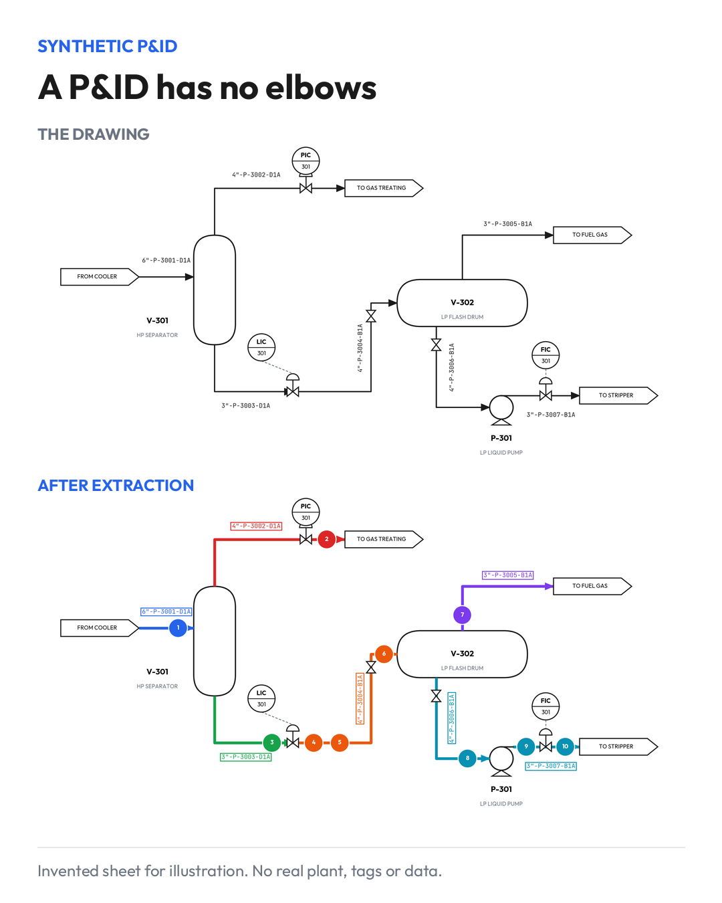

# A P&ID Has No Elbows

Tuesday 2026-11-24

A P&ID has no elbows. If your CML plan was built from P&IDs alone, check what that left out.

Take the letdown section on the image, an invented sheet: high pressure separator, letdown valve, flash drum, pump. I have been automating the first pass of CML placement from drawings like this. The extraction gives seven lines, six circuits and ten proposed CMLs, and every one sits at something the drawing shows: either side of the letdown valve, after the pressure control valve, at vessel nozzles, at the pump suction and discharge.

That first pass is worth having. Those are real disturbance points, and none of them gets forgotten on sheet 140 of 300.

Now put the isometric for the flashing line next to it. Say it shows five elbows and a low point between the valve and the drum. The drawing based plan has three CMLs on that line and none of them is on an elbow. The corners on a P&ID are drafting, not piping.

The gap matters because of where the metal goes. API 570 5.6.2 says that, where appropriate, measurements should cover the four quadrants, "with special attention to the inside and outside radius of elbows and tees where corrosion/erosion could increase corrosion rates". Downstream of a letdown valve, in flashing two phase flow, the first elbows are where I would expect the lowest wall on the sheet.

So the output is two lists, and it says so: locations the drawing can justify, and a reminder of what only the isometric and a walkdown can add.

A quick test for your own program: pick one line downstream of a control valve, count the elbows on its isometric, and count the CMLs on them.

How much of your CML placement was done from the P&ID alone?

## Requirements quoted

> "with special attention to the inside and outside radius of elbows and tees where corrosion/erosion could increase corrosion rates"
>
> API 570, 5.6.2

## Note

Invented sheet: no real plant, tags or data. Reference: API 570, 4th Edition (2016), 5.6.2 CML Monitoring; 7.9.6 describes what an inspection isometric should show.
