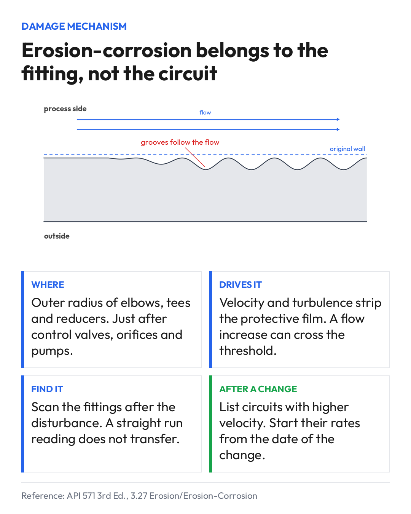

# The Debottleneck Nobody Told the CMLs About

Wednesday 2026-11-25

The unit was debottlenecked two years ago. Has anyone asked what 20% more flow did to the elbows?

Take a 6 inch carbon steel sour water line. Before the project every CML read about 0.06 mm/yr and the circuit was called uniform. The first elbow after the control valve was at 5.9 mm against 4.0 mm required: over 30 years of life, so the next thickness survey sits at the 10 year maximum for its class.

That rate belonged to the old velocity. The steel is protected by a film of corrosion product. Raise the velocity and at some point the flow strips it, at the places where turbulence is highest. API 571 3.27.3 notes that in some cases "there is a threshold velocity below which corrosion is minimal but above which corrosion becomes significant".

Suppose the elbow is now losing 0.30 mm/yr. The same 1.9 mm of margin lasts about 6 years. The wall reaches its limit before the next scheduled reading, and the straight run CMLs, still at 0.06, keep reporting a healthy circuit.

That is the trap with erosion-corrosion: it belongs to a fitting and an operating condition, not to a circuit. API 571 3.27.7 is blunt about the inspection side: "Randomly placed point UT readings may not be effective if they are not placed at the locations of potential susceptibility."

What I would do after any change in throughput or pressure drop:

List the circuits whose velocity went up.

Scan the outer radius of the first fittings after valves, orifices and pumps.

Start the rate at those points from the date of the change, not from the original baseline.

Which of your circuits changed flow rate since their CMLs were chosen?

## Requirements quoted

> "there is a threshold velocity below which corrosion is minimal but above which corrosion becomes significant"
>
> API 571, 3.27.3

> "Randomly placed point UT readings may not be effective if they are not placed at the locations of potential susceptibility."
>
> API 571, 3.27.7

## Note

Reference: API 571, 3rd Edition (2020), 3.27 Erosion/Erosion-Corrosion. The line, the rates and the 0.30 mm/yr figure are an illustrative case, not measured data.
