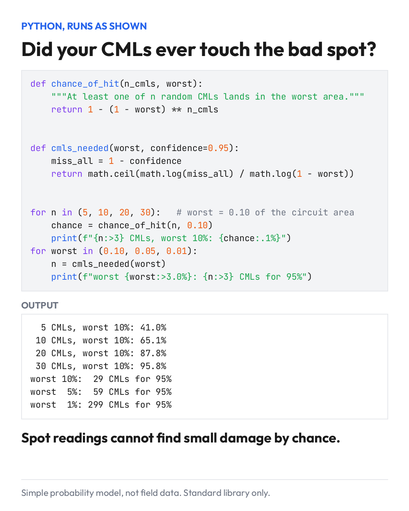

# Clean Because It Is Healthy, or Because of Where You Looked?

Thursday 2026-11-26

Ten CMLs, fifteen years of clean readings. Is the circuit healthy, or did the ten points simply never land on the bad spot?

That question comes up in audits and after leaks, and it has a number attached. Suppose the damaged part of a circuit covers a fraction of its surface, and the CMLs were placed without knowing where. The chance that at least one touches the damage is 1 minus the chance that all of them miss.

The code on the image runs it. With damage on 10% of the circuit, 5 CMLs give a 41.0% chance of a hit, 10 give 65.1%, 20 give 87.8% and 30 give 95.8%. So ten clean readings leave about one chance in three that the worst tenth was never measured.

Now shrink the damage. For 95% confidence of one hit you need 29 CMLs when the bad area is 10% of the circuit, 59 at 5%, and 299 at 1%. A thin area at one elbow is far below 1% of a circuit. No affordable number of spot readings finds it by chance.

That is why the usual defence, counting clean CMLs, fails. API 570 7.1.3 draws the same line for statistics: "Statistical analysis employing point measurements is not applicable to piping circuits with significant localized unpredictable corrosion mechanisms".

Two things beat the arithmetic. Knowledge: a CML placed where the mechanism takes metal is not a random draw. And area: a scan examines hundreds of times more surface than a spot.

For your next circuit review, write one line per circuit: what is the smallest damaged area these CMLs would probably have found? If the answer is a tenth of the pipe, the clean history covers general corrosion only.

How do you argue that a circuit's CMLs are enough?

## Requirements quoted

> "Statistical analysis employing point measurements is not applicable to piping circuits with significant localized unpredictable corrosion mechanisms"
>
> API 570, 7.1.3

## Note

Runs as shown, standard library only. Reference: API 570, 4th Edition (2016), 7.1.3. The model is crude on purpose: independent points, random placement, one damaged area. It is not field data.
