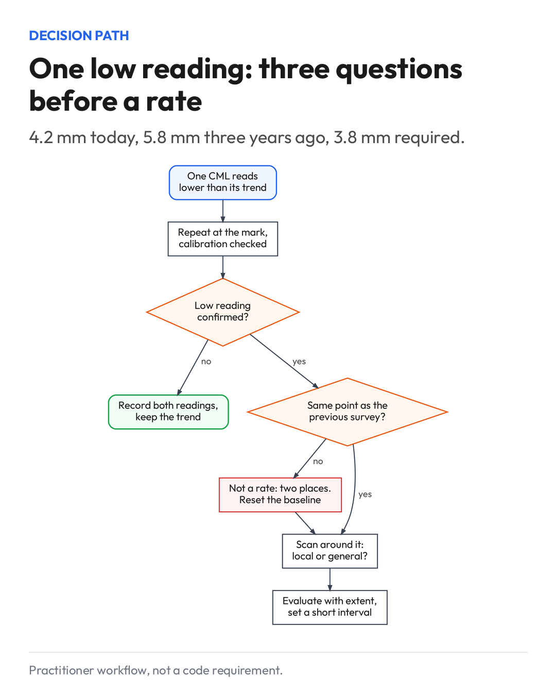

# One Low Reading and a Morning Meeting

Friday 2026-11-27

One CML reads 4.2 mm. Three years ago it read 5.8. Required thickness is 3.8 mm, and the morning meeting wants a date.

The arithmetic is quick and frightening. A loss of 1.6 mm in three years is 0.53 mm/yr. With 0.4 mm of margin, remaining life is nine months. The usual responses are to plan a shutdown on that number, or to call it a bad reading and move on. Both skip the same three steps.

Is it real? Repeat at the marked point, calibration checked, a second technician if possible. Keep both values.

Was it the same place? This is where most of these cases turn. API 570 5.7.1: "For corrosion rate determinations to be valid, it is important that measurements on the thinnest point be repeated as closely as possible to the same location." If the earlier reading was taken 30 mm away, 0.53 mm/yr is not a rate. It is the difference between two places.

How big is it? Scan around the point. If the wall recovers within a hand's width, the loss is localized, the single point probably missed the deepest part, and the other fittings with the same geometry are next. If it is low in every direction, it is general and the neighbouring CMLs should show it.

Only then does the number mean something. A confirmed 4.2 mm in a small local area, with no rate history at that exact spot, goes to the inspector and piping engineer for evaluation and a short re-inspection interval. A confirmed 4.2 mm over the whole elbow is a different conversation.

What I want in the record: both readings, the scan extent, and one sentence saying which case it was.

What is your first action when a single CML drops out of trend?

## Requirements quoted

> "For corrosion rate determinations to be valid, it is important that measurements on the thinnest point be repeated as closely as possible to the same location."
>
> API 570, 5.7.1

## Note

Reference: API 570, 4th Edition (2016), 5.7.1. The flow on the image is a practitioner work process, not a code requirement, and the numbers are an illustrative case.
